I'm AJ, a software engineer of 10+ years.
I hand real work to AI agents and show 150k+ followers what comes back.

### Building now

| | |
|---|---|
| **[gmclip](https://gmclip.com)** | A video editor where you cut by editing the words, with an MCP server so an agent can do the edit. |
| **[agentbattler](https://agentbattler.com)** | Coding agents write chess bots and the bots play each other, as a reproducible [benchmark](https://github.com/aj47/agentbattler-bench). |
| **[berigame](https://beta.berigame.com)** | A cute MMO that agents can play alongside people. |

### Shipped earlier

| | | |
|---|---|---|
| **[Clickolas Cage](https://github.com/aj47/clickolas-cage)** | A Chrome extension that browses the web toward a goal with an LLM as its brain, started in 2023 before browser agents went mainstream. |  |
| **[SpeakMCP](https://github.com/aj47/SpeakMCP)** | Spawn an agent anywhere on your desktop with one keypress. |  |
| **[100x Orchestrator](https://github.com/aj47/100x-orchestrator)** | Runs a fleet of coding agents in separate workspaces and streams what each one is doing. |  |
| **[Chaos Coder](https://chaoscoder.net)** | One prompt returns 9 different websites to pick from and edit. |  |
| **[DotAgents](https://github.com/aj47/dotagents-mono)** | A desktop app that puts an AI team one voice command away, built on the open [.agents protocol](https://github.com/aj47/dotagentsprotocol-website). |  |
| **[CreatorToolHub](https://creatortoolhub.com)** | Tools for content creators. |  |

Come build with us in the [TechFren Discord](https://discord.gg/cK9WeQ7jPq).
